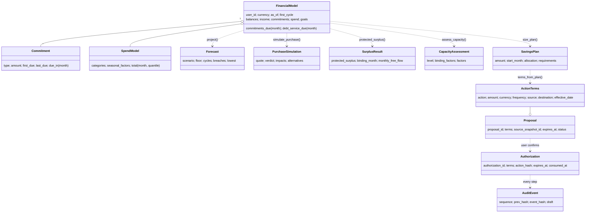

# Architecture guide (for developers)

The *why* is in [SCOPE.md §5](SCOPE.md#5-architecture). This page is the *how*: where code goes and the recipes for the changes you will make most often.

## The one rule

```
adapters  ──►  application  ──►  domain
(FastAPI,       (use cases,       (pure rules:
 SQLite,         ports,            money, forecast,
 LLM, Jev)       services)         gate, audit)
                      ▲
bootstrap ────────────┘  (wires concrete adapters into use cases; nothing imports bootstrap)
```

- `domain/` and `application/` import **only the Python standard library**. No FastAPI, no pydantic, no SDKs, no `datetime.now()`, no randomness, no file or network access.
- Adapters implement ports. Inbound adapters (HTTP, CLI) call use cases through `ApplicationServices`. Outbound adapters (LLM, Jev, DB, bank) are passed into use cases by `bootstrap/container.py`.
- `tests/architecture/test_dependency_rule.py` fails the build if any of this is broken.

## Where does X go?

| You are adding… | Put it in | Test it in |
|---|---|---|
| A formula, threshold or financial rule | `domain/finance/` (+ parameter in `params.py`) | `tests/golden`, `tests/unit/test_invariants.py` |
| A new permission rule or block reason | `domain/permissions/policy.py` | `tests/security` |
| A new step in a flow (e.g. "compare two purchases") | a method in `application/use_cases/*` | `tests/application` |
| A new agent tool | contract + catalog entry (recipe below) | `tests/contract`, `tests/security` |
| A new LLM provider | `adapters/outbound/llm/<provider>.py` implementing `LanguageModel` | a fake-server test, plus manual |
| The Jev integration | `adapters/outbound/decision/jev.py` | `tests/security` (S10) |
| A new database | `adapters/outbound/persistence/<db>.py` | add it to the `stores` fixture in `tests/adapters` |
| An HTTP endpoint | `adapters/inbound/http/app.py` (thin: parse → use case → `to_primitive`) | `tests/http` |
| A config switch | `bootstrap/config.py` + `.env.example` + `container.py` | — |
| A new bank statement layout (cartola) | a `SheetBank` (Excel export) or `Bank` (PDF/image) subclass in `adapters/outbound/statements/banks/` (recipe below) | `tests/adapters/test_statement_formats.py` / `test_banks.py` with a synthetic sample |
| A different spending classifier (model or method) | a `TransactionClassifier` adapter + a `CLASSIFIERS` entry in `container.py` (recipe below) | `tests/adapters/test_classifier.py` |
| A redaction rule (a kind of personal data the rules miss) | `domain/privacy/redaction.py` | `tests/unit/test_redaction.py`, `tests/property/test_redaction_properties.py` |
| A personal-data detector (a second layer after the rules) | a `PersonalDataDetector` adapter in `adapters/outbound/privacy/` + a `DETECTORS` entry in `container.py` (recipe below) | a fake-server test in `tests/adapters`, plus S15 |
| A frontend screen | `web/`, consuming `contracts/` | — |

## Recipes

### Add an agent tool
1. Write `contracts/tools/<name>.input.schema.json` with `description` (3–4 sentences the model will read), `x-tier`, `x-owner` and the input schema. If it returns new data, add `contracts/outputs/<name>.schema.json`.
2. Implement the behaviour as a use-case method returning an `Envelope` (facts and warnings) or an `ActionOutcome`.
3. Register it in `application/catalog.py` with its tier. The tier lives in code; the contract test checks that it matches `x-tier`.
4. If the scripted model should use it, add a step in `adapters/outbound/llm/scripted.py`, and teach the narrator in `application/services/narration.py` to describe it.
5. Run `make test`: the contract test checks names, tiers and output schemas.

### Add an LLM provider (Role B)
Implement `respond(request: ModelRequest) -> ModelTurn` and map `UserEntry` / `AssistantEntry` / `ToolResultEntry` to the provider's format (see `anthropic.py`). Raise `LanguageModelUnavailable` on any network or API error so `FallbackLanguageModel` can switch to the scripted model. Add a value for `NL_LLM` in `container.py`.

### Implement Jev (Role B)
Map `ChoiceQuestion → Choice`, `ScoreQuestion → Score`, `YesNoQuestion → Noul`, and return `Judgment(label, probabilities, confidence, source)`. Confirm field names in the TypeSafe docs first. Raise `DecisionModelUnavailable` on errors. Then set `NL_DECISION_CHAIN=jev,rules`.

### Read a new bank's statements
The reader routes each file by its bytes, then a layout gives it meaning. Only the layout is per bank:

```
bytes ─┬─ .xlsx ─► spreadsheet.read_workbook ─► Sheet (rows of cell text)      standard library; no PDF, no OCR
       │            ─► SheetBank.parse(sheets) ─► BankStatement
       └─ PDF / image ─► ocr_tabular.read_pages ─► Page (word boxes: text layer, or EasyOCR on scans/photos only)
                     ─► Bank.read(pages) ─► BankStatement per statement in the file
                          default: rebuild(page, bank.table) ─► Table per page ─► bank.parse(tables)
                          or: parse the page lines (card statements, whose rows are regular text)
      ─► StatementRedactor ─► BankStatement with placeholders, ****3456    ← domain rules + optional detector (ADR-028)
      ─► domain reconcile() ─► stored, verified or unverified (+ warning), audited STATEMENT_IMPORTED
```

The statement id hashes the statement as read, so the same cartola imported twice is still a duplicate. From redaction on, only the clean copy exists, and if any statement in a file cannot be redacted, nothing from that file is stored. A `Bank` never redacts: it returns what the bank printed.

1. Get a sample and **never commit it**: real statements go in `cartolas/` (git-ignored). For a spreadsheet, look at `read_workbook(...)[0].rows`; for a PDF, at `read_pages(...)[0].text` or `.boxes`. Find the labels, where the amounts sit and what ends the table.
2. Add `banks/<bank>.py`. Every layout has a stable `code`, `recognizes(text)` (words only that layout prints, already `norm_text`-ed) and an `account_type` (`CHECKING`, or `CREDIT_CARD`, which detects a card).
   - **Excel export:** subclass `SheetBank` and implement `parse(sheets)`. `Sheet.right_of(label)` / `below(label)` read label/value cells; amounts in number cells go through `cell_money(text, decimals)`, printed amounts ('$100.000', '-12,50 US$') through `parse_money(text, decimals)`.
   - **PDF with a column table:** subclass `Bank` with `table = TableSpec(header_required, header_tokens, stop_markers)` and `parse(tables)`. Use `parse_clp`, `day_month` and `column_index`; they already tolerate the OCR noise seen so far.
   - **PDF whose lines are regular text** (e.g. card statements): subclass `Bank` and override `read(pages)`. Return several statements if the file holds several (national CLP + international USD).
   Raise `TableError` on any cell that does not fit, never guess.
3. Return everything the bank printed, because reconciliation can only verify what was printed: the summary (`StatementSummary`, any field may be None), daily balances, `section_totals` for printed subtotals (each line names its `section`), and, for a card, `CardObligations` (amount due, minimum, due date, limits, and the printed cuota schedule if there is one). Signs are the holder's: charges negative, and a card's debt negative.
4. On a card, set each line's `kind` (`purchase`, `payment`, `refund`, `fee`) and its `Installment` (n of N, purchase amount, rate). Posting depends on it: a payment is a `movement`, never income. An export of **unbilled** movements is `provisional=True`, so it is checked and stored but never posted.
5. Register it in `banks/__init__.py` (`BANKS` for documents, `SHEET_BANKS` for spreadsheets).
6. Add a synthetic sample to `tests/statement_samples.py` (`xlsx(rows)` writes a workbook with the standard library; `card_pdf` draws a card statement), and tests for the happy path and for a misprinted total. `test_local_real_cartolas_reconcile` also runs on every PDF and `.xlsx` in your local `cartolas/`.

Amounts are evidence, not authority (ADR-020): a statement that does not reconcile is stored as **unverified** with a `STATEMENT_UNVERIFIED` warning (ADR-021 adds manual review), and low OCR confidence only warns (`OCR_LOW_CONFIDENCE`), because reconciliation already checks every amount and date. Card statements and the Excel pipeline: ADR-031. Feeding card obligations into the forecast: ADR-029 (plan).

### Categorize statement lines (change the classifier)
A verified statement is posted to the transaction ledger on import:

```
StoredStatement (verified) ─► charges' descriptions ─► TransactionClassifier.classify ─► CategoryGuess per charge   ← adapter (swappable)
      ─► domain post_statement: amount and kind from the statement; guess accepted only if in CATEGORIES and ≥ 0.5   ← domain (fixed)
      ─► TransactionStore (once per user and txn_id) ─► GET /v1/transactions, `neural-ledger transactions`
```

On a checking account deposits are `income` by rule and charges are `purchase`, with the accepted category or `uncategorized`. On a credit card the line's kind decides: a payment is `card_payment` with category `movement` by rule, and purchases, refunds and fees are classified. Provisional statements (unbilled movements) are never posted. Every transaction records which classifier (name + training-data hash) chose its category, and its confidence. An unverified statement, or an unavailable classifier, posts nothing and warns `NOT_POSTED`; importing the file again backfills.

- **Another scikit-learn estimator:** pass another pipeline factory, e.g. `SklearnTextClassifier(my_factory, method="logreg")`, and register it under a new name in `CLASSIFIERS`. Select it with `NL_CLASSIFIER`.
- **Another method entirely** (rules, an LLM, a remote model): implement `classify(descriptions) -> [CategoryGuess]` and a `name` in `adapters/outbound/classifier/<method>.py`, raise `ClassifierUnavailable` when it cannot answer, and register it. Nothing else changes.
- **Better categories:** add labelled rows to `adapters/outbound/classifier/training/categories.csv` (`description,category`, labels from `CATEGORIES`). The classifier's name changes with the data, so old and new categorizations stay distinguishable. Never add rows from a real statement: the repository is public. The rows go through the same redaction rules as imported lines, so the model learns `Transf a [PERSON]`, never a name; a rules change renames the model too.

Existing transactions keep their category on re-import; re-categorizing the ledger with a new model is not built yet.

**Decided, not built yet** (see `docs/DECISIONS.md`):
- ADR-021: unreconciled statements go to the user for manual correction and are posted either way, flagged.
- ADR-023: categories can be changed by the user.
- ADR-024: new category `movement` ("Movimiento") for own transfers, card payments and investments.

Open issues: O-1 (re-read treated as a duplicate) and O-2 (vocabulary, training data, re-categorization).

### Add a personal-data detector
Personal data is removed at import in two layers (ADR-028). The domain rules always run; a detector runs after them, on the raw text of every line, and its spans can only add masking. To add one, for example another service or a local model:

1. Write `adapters/outbound/privacy/<name>.py` with a class that has a `name` and `detect(texts) -> [[Span, …], …]`: one list per text, in the same order, with offsets into that text and a `Placeholder` per span. Map your service's categories onto the six placeholder codes; never invent new codes without a contract change.
2. Raise `DetectorUnavailable` on any network, HTTP or format error. The import still succeeds with the rules alone, flagged as degraded. Never put the text or a key in an error message or a log.
3. Add an entry to `DETECTORS` in `bootstrap/container.py`. Add its settings, if any, to `config.py` and `.env.example`, with secrets empty and named `*_API_KEY`.
4. Test it against a local fake server (see `tests/adapters/test_azure_language.py`): the request, offsets mapped back per line, the service limits, and every error.
5. If it sends text out of the process, say so in `docs/SECURITY.md` and keep it off by default.

Select it with `NL_PII_DETECTOR=<name>`; `/health` reports it as `pii_detector`. The rules themselves live in `domain/privacy/redaction.py`; extend their word lists when a real cartola (kept local in `cartolas/`) shows a new pattern.

### Switch from fixtures to the ledger (done)
- `data/ledgers/<user>.json` is written by `backend/tests/fixtures/ledger_generator.py` (`make ledgers`).
- `domain/finance/estimation.py:estimate_model` turns a `LedgerSnapshot` into the `FinancialModel`; pay cycles come from `domain/finance/paycycle.py`, the same labelling as the forecast.
- `adapters/outbound/fixtures/ledger_source.py:LedgerModelSource` parses the ledger and runs the estimators; `NL_MODEL_SOURCE=ledger` selects it in `container.py`. User records (tolerance) still come from the persona files.

## Domain model (for the empty Class Diagram page)



## Use cases (for the empty Use Cases page)

| Actor | Use case | Tier | Entry point |
|---|---|---|---|
| User | Ask a question in chat | — | `POST /v1/chat` |
| User | See balance, commitments, forecast | T0/T1 | `GET /v1/state`, `/v1/commitments`, `/v1/forecast` |
| User | Simulate a purchase | T1 | `POST /v1/simulate-purchase` |
| User | See protected surplus and capacity | T1 | `GET /v1/protected-surplus`, `/v1/capacity` |
| Agent | Propose a savings rule from a plan | T1 | tool `propose_savings_rule` |
| User | Confirm the exact terms | T2 | `POST /v1/actions/proposals/{id}/confirm` (UI only) |
| User or agent | Execute a confirmed action | T2 | `POST /v1/actions/execute`, tool `execute_sandbox_action` |
| Agent | Anything in T3 | T3 | always blocked and audited |
| Judge or user | Inspect the audit log and verify the chain | T0 | `GET /v1/audit`, `/v1/audit/verify` |

## Runtime modes

| Mode | Settings | Use |
|---|---|---|
| Offline (default) | `NL_LLM=scripted`, `NL_DECISION_CHAIN=rules`, `NL_PII_DETECTOR=none` | CI, `docker compose up` without keys, demo recording, S10 |
| Live | `NL_LLM=anthropic` (or another provider), `NL_DECISION_CHAIN=jev,rules` | The real demo; falls back to offline pieces on outages |
| Azure redaction | `NL_PII_DETECTOR=azure` with `AZURE_LANGUAGE_ENDPOINT` and `AZURE_LANGUAGE_API_KEY` | Local tests with the team's key only: it sends statement text to Microsoft (`docs/SECURITY.md`) |
| Deterministic | `NL_CLOCK=fixed`, `NL_IDS=sequential` | Reproducible recordings and evidence |

`GET /health` reports the mode, so the demo never runs in the wrong one by accident.
