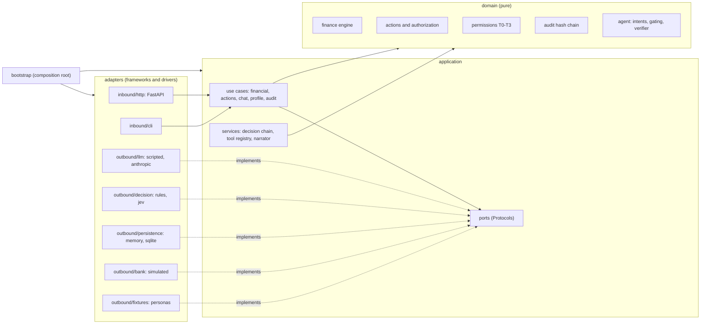
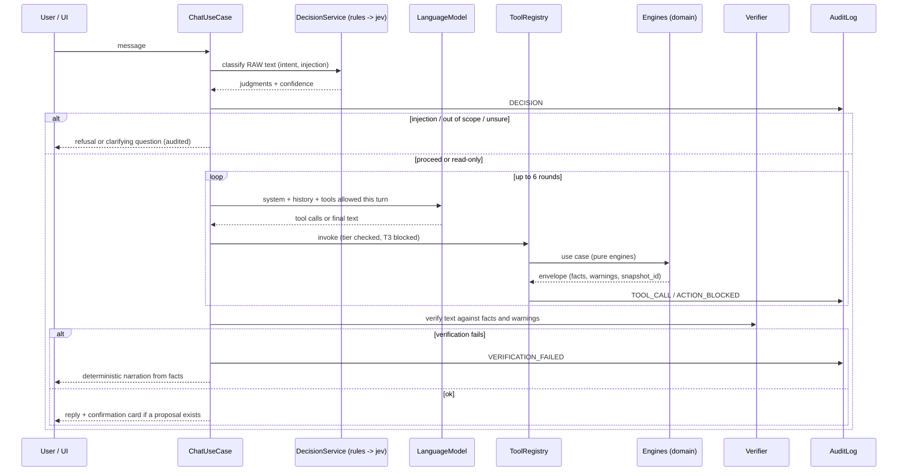
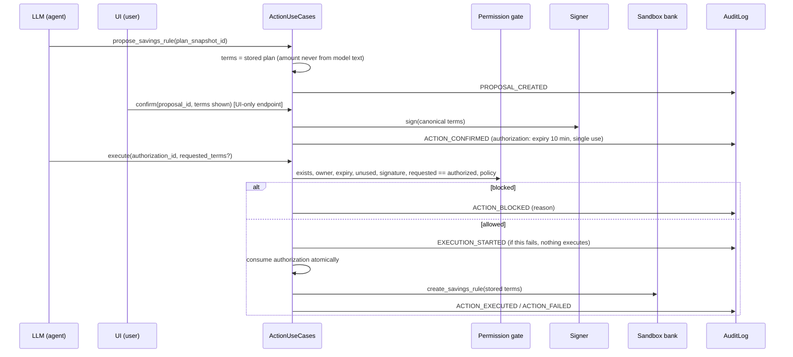

# Neural Ledger: Scope and Architecture Baseline

> **Version 1.0 · 2026-10-10 · Proposed baseline. Needs team sign-off at the next sync.**
> Consolidates the Notion project page, *Spec v0* and *Financial Core: Design & Architecture* (Bruno, Oct 8), adds the architecture, and lists what reviewing them turned up.
>
> **Source of truth, in order:** `contracts/` (JSON Schemas) > this document > Notion drafts. When they disagree, the higher one wins and the lower one gets fixed.

---

## 1. What we are building

**Entry:** FinTechathon 2026 (8th Shenzhen International FinTech Competition), International Track, theme *"Agent Wallet: AI Agent Digital Wallet"*, **Topic A: Personal Finance Assistant**.

**One line:** an AI cash-flow copilot that knows how much of your money is already committed to the future (cuotas, rent, goals), tells you what you can actually spend or save, and acts on your wallet only inside limits you confirmed.

**Core idea:** *balance ≠ available ≠ protected surplus.*

| Concept | Meaning | Camila |
|---|---|---|
| Balance | What the bank shows | 920,000 CLP |
| Available | What each pay cycle leaves after commitments and conservative spending | −660,000 in Dec 2026 |
| Protected surplus | How much could leave checking today without any future conservative trough falling below the floor | **20,000 CLP** (binding Dec 2026) |

**The agent answers three questions, in increasing difficulty:**
1. *Can I afford this?* Purchase simulator with a verdict and alternatives.
2. *How much is actually available after protecting future commitments?* Forecast and protected surplus.
3. *What should I do with the surplus, and can you do it?* Savings-rule proposal → user confirmation → sandbox execution → audit.

**Positioning for the track theme:** the "agent wallet" is an agent with a **bounded mandate**. It reads (T0), analyzes (T1), executes only what the user confirmed (T2), and can never do T3 things. The innovation is not that the AI obeys. It reasons about the future and **refuses when the numbers say no**.

## 2. Problem framing (keep it, but sharpen it)

The evidence on the Notion page: Chileans score 1.6/5 in financial literacy while rating themselves 3/5, and about 20% understand interest rates (Centro de Políticas Públicas UC). Household debt is about 46% of GDP (Banco Central de Chile). 15% of debtors divert over half their income to debt (CMF). Globally, 33% of adults are financially literate (S&P Global FinLit Survey).

What to fix before the deck:
- **The product fixes commitment blindness, not literacy in general.** The balance looks healthy while the money is already spoken for. Pitch that problem, and use the literacy data as the reason people can't do this math alone.
- **Show just-in-time literacy:** the simulator states the real cost at the moment of decision. 400,000 in 12 cuotas costs 467,940 (34.5% effective annual).
- The S&P figure comes from a 2014 survey. Label the year or add a newer source (e.g. OECD/INFE 2023). Fix the typo "BBCh" (it is **BCCh**). Cite the ICI claim properly or drop it.
- The judges are in Shenzhen. Present Chile as the case study and installment credit as a global pattern (cuotas ≈ installment plans / BNPL / 分期). Every amount carries an ISO currency code and nothing in the engine is Chile-specific except the fixtures.

## 3. Users and the demo

**Personas** (synthetic data):
- **Camila (primary):** salaried, 1.8M net; three cuotas overlapping in December; trip goal of 1.8M by Sep 2027; reserve below target.
- **Diego (contrast):** same balances and purchase, freelance income (P50 1.8M, P20 1.3M). Same question, different answer.

**Demo arc (4 to 5 minutes).** Every scene is backed by a golden test and already runs offline (`make demo`):

| # | Scene | Engine answer (golden) |
|---|---|---|
| 1 | Healthy balance, but the agent flags a December crunch | E01: lowest conservative headroom 20,000 in Dec 2026 (trough 170,000) |
| 2 | Laptop, 400k in 12 cuotas: fits typical, breaches conservative | E02/E03: cuota 38,995; `FITS_TYPICAL_ONLY`; Dec trough 131,005, 18,995 below the floor |
| 3 | "Just make it work" → alternatives, not a bypass | E04: start in Jan 2027 fits; 24 cuotas still breaches; about 205,000 fits at 12 cuotas |
| 4 | Protected surplus; tolerance vs. capacity | E05/E06/E09: capacity conservative (headroom binding); aggressive tolerance → conservative profile |
| 5 | Agent proposes 100k/month from Jan 2027; Camila confirms | E07/E08: trip funded by Sep 2027; reserve top-up from Oct 2027 |
| 6 | A request for 700k is blocked and the audit log shows why | S03: `AUTHORIZATION_MISMATCH` (authorized 100,000, requested 700,000) |

**Open (D-09):** if Camila takes alternative (a), the rule becomes 80,000 (E10). Recommendation: she **declines** the laptop for now, which keeps the 100,000 story. Show E10 only if asked.

## 4. Scope

### Must (MVP: the demo path, runnable offline)

| Capability | Acceptance | Role |
|---|---|---|
| Camila fixture: calibrated model and a 12-month ledger that reproduces it | `tests/golden/test_estimation.py` passes | E, A |
| Commitment reconstruction (cuotas, rent, subscriptions) with evidence ids | Golden E01 inputs from the ledger | A |
| Forecast: typical, conservative, stress (6-month dashboard, 12-month checks) | E01, E11 | A |
| Purchase simulator: verdict and alternatives | E02–E04 | A |
| Protected surplus | E09 | A |
| Capacity, tolerance, permitted profile | E05, E06 | A, B |
| Savings plan and allocation | E07, E08 | A |
| Chat: intent → tools → explanation, with one real LLM provider | Demo arc | B |
| **Deterministic response verifier** (numbers and warnings vs. facts). *Promoted from Should: it is cheap and earns security points.* | S07, S08 | B |
| Confirmation contract: signed terms, expiry, single use | S03, S04, S05, S11 | C |
| Permission gate T0–T3 | S02, S06 | C |
| Sandbox bank with a recurring savings rule | Execution receipts | C |
| Hash-chained audit log and export | `evidence/` | C |
| Dashboard, chat, what-if chart, confirmation card, audit view | Scenes 1–6 | D |
| Security and suitability tests | S01–S12, H1–H5 | E |
| **Offline mode** (scripted LLM + rules decision model). *New.* Needed for S10, CI, `docker compose up` without keys, and recording the video. | No keys needed | B, C |
| Clean `docker compose up` | CI job | C |

### Should
Diego (E12–E14) · Jev adapter (go/no-go Oct 14) · semantic verifier through the decision model · forecast backtest, labelled *implementation validation* · intent evaluation set (60–100 examples) to calibrate the gating thresholds · SQLite persistence (already in the skeleton).

### Cut or deferred
- **Graph memory → cut.** The typed user record (§5.6) covers the need.
- Stretch, only after the Oct 17 freeze: proactive alerts, multilingual UI.
- Out of scope (unchanged): real banking, stock picking, crypto, brokerage, tax optimization, investment advice. The final step is a **savings or buffer rule**.

## 5. Architecture

### 5.1 Principles (non-negotiable)
1. **The dependency rule.** Code depends inward only: `adapters → application → domain`. Domain and application import nothing but the Python standard library. `tests/architecture/` enforces this on every run.
2. **Deterministic authority.** Only deterministic code computes money and authorizes actions. Models (LLM, Jev) interpret language. They never decide an amount, a verdict or a permission.
3. **The application orchestrates; the LLM is a plugin.** Use cases own the control flow. The LLM picks tools from a fixed registry and writes explanations. It cannot confirm, and execution reads its terms from the stored authorization, never from model text.
4. **Everything external is a port.** The LLM provider, the decision model (Jev), persistence, the sandbox bank, clock, ids, signing and data source are all ports. Each has an offline adapter, so the system runs and tests with zero external services.
5. **Contracts first.** `contracts/` is the source of truth for tools, outputs, actions, audit events and chat. LLM tool definitions are loaded from it, and contract tests validate real outputs against it.
6. **One composition root.** Only `bootstrap/` knows concrete adapters, and environment variables choose them. There is no DI framework.
7. **Reproducible.** The same snapshot and the same `params_version` give the same output. Every output carries `snapshot_id`, `params_version`, `facts[]` and `warnings[]`.
8. **Fail closed.** Unknown data returns `INSUFFICIENT_DATA`. If no decision model can answer, the turn is read-only. If the audit write fails, nothing executes.

### 5.2 Layers



| Layer | Contains | May import |
|---|---|---|
| `domain/` | money and months, finance engine (forecast, simulator, surplus, plan, capacity), action terms and authorization, permission gate, audit chain, intents, gating, verifier | standard library only |
| `application/` | use cases, ports (Protocols), decision chain, tool registry and catalog, narrator, prompts | domain + standard library |
| `adapters/` | HTTP (FastAPI), CLI, LLM providers, decision models, persistence, sandbox bank, fixtures, clock, ids, signer | anything except `bootstrap`; inbound and outbound do not import each other |
| `bootstrap/` | settings, contract loader, container, ASGI and CLI entry points | everything |

### 5.3 Ports and adapters

| Port | Purpose | Adapters now | Later |
|---|---|---|---|
| `FinancialModelSource` | Where the estimated model comes from | `PersonaFixtureSource` (calibrated JSON) | ledger source = Role A estimators over the sandbox ledger |
| `LanguageModel` | Conversation, tool choice, explanation | `ScriptedLanguageModel` (offline), `AnthropicLanguageModel` (reference) | OpenAI, Gemini: one file each |
| `DecisionModel` | Closed questions about language (intent, injection, tolerance, consistency) | `RulesDecisionModel` | `JevDecisionModel` (stub, Role B), LLM judge |
| `SandboxBank` | Execute approved actions | `SimulatedSandboxBank` | — |
| `ActionRepository` | Proposals and single-use authorizations | memory, SQLite | Postgres |
| `AuditLog` | Append-only, hash-chained | memory, SQLite | Postgres |
| `SnapshotStore` | Computed plans by snapshot id (where proposal amounts come from) | memory | SQLite |
| `UserProfileStore` | Typed user record | memory (seeded from fixtures) | SQLite |
| `ConversationStore` | Session history | memory | SQLite |
| `Signer` | HMAC over canonical terms | `HmacSigner` (env secret) | KMS |
| `Clock`, `IdGenerator` | Testability | system/fixed, uuid/sequential | — |

### 5.4 One chat turn



### 5.5 Confirm and execute



### 5.6 The decision model and the user record

**Decision model (answering Vicente's comment).** Vicente is right that closed, binary decisions should not go to a generative LLM, and Jev is built for exactly that. The baseline:
- The port is shaped like Jev's primitives, but it belongs to us: `ChoiceQuestion`, `ScoreQuestion`, `YesNoQuestion` → `Judgment(label, probabilities, confidence, source)`.
- Adapters: **rules** (deterministic keywords, always available), **Jev**, and optionally an LLM judge. The runtime order is configuration (`NL_DECISION_CHAIN=jev,rules`), not architecture.
- Build order: rules first (needed for tests, CI and a deterministic demo), Jev second. Public sources list Jev on Vercel AI Gateway and Cloudflare Workers AI without a waitlist, so the access risk may be lower than when Spec v0 was written (verify with TypeSafe). Go/no-go stays on Oct 14.
- Scope clarification: **no money decision goes to any model.** The decision model only judges language (intent, injection, tolerance signals, consistency of explanations). Verdicts and permissions are deterministic code.
- Gating: confidence ≥ 0.80 proceeds; 0.55–0.80 asks a clarifying question; below 0.55, or no model available, the turn is read-only. Thresholds are starting values and must be calibrated on the evaluation set.

**User record (David's proposal).** "Complete access" to a free-form user file would let any injected text persist into every future conversation (memory poisoning), and it would collect more personal data than the demo needs. Baseline: a **typed** `UserProfile` (display name, language, declared tolerance, questionnaire answers). The agent reads it (T0). Changes are proposals the user confirms, and it never stores free-text instructions.

### 5.7 Tech stack (proposed defaults, decision D-01)

| Layer | Default | Why | Alternatives |
|---|---|---|---|
| Core (domain + application) | Python 3.12, standard library only | Bruno's formulas are Python; zero dependencies | — |
| HTTP | FastAPI, inside the adapter only | Typed and fast | Any framework: swap one adapter |
| Persistence | in-memory → SQLite (stdlib `sqlite3`) | No services; ACID for single-use authorizations and the audit chain | Postgres behind the same ports |
| LLM | scripted (offline) + one real provider | Provider-neutral port | Anthropic (reference adapter), OpenAI, Gemini |
| Decision model | rules → Jev | §5.6 | LLM judge |
| Frontend | Whatever Vicente ships fastest; web first | The demo is a dashboard and a chat | Angular if he already knows it; wrap with Ionic later if needed |
| Packaging | `pyproject.toml`: core has zero dependencies; extras `api`, `dev` | | uv |
| Infra | Docker Compose (api, and web later); GitHub Actions CI | `docker compose up` is a deliverable | — |

On MongoDB and DynamoDB: neither is needed. DynamoDB ties `docker compose up` to AWS. Mongo adds a second data paradigm to a ledger that needs uniqueness and transactions (single-use authorizations, an append-only audit log). The typed user record fits a JSON column. If the team still wants Mongo, it is one more adapter behind the same ports.

### 5.8 Repository layout

```
neural-ledger/
  README.md  CLAUDE.md  CONTRIBUTING.md  Makefile  docker-compose.yml  .env.example
  contracts/        JSON Schemas: common, tools, outputs, actions, audit, chat (source of truth)
  backend/
    src/neural_ledger/
      domain/       shared, ledger, finance, actions, permissions, audit, agent, user
      application/  ports, conversation types, use_cases/, services/, catalog, facade
      adapters/     inbound/{http,cli}  outbound/{fixtures,persistence,bank,llm,decision,system,text}
      bootstrap/    config, contracts loader, container, asgi, cli
    tests/          architecture, golden, unit, security, contract, adapters, application, http
  data/             personas/ (calibrated fixtures), generator/ (Role E), ledgers/ (generated)
  web/              Role D
  docs/             SCOPE, ARCHITECTURE, SECURITY, DECISIONS
  evidence/         test-results, sandbox-logs, screenshots (submission evidence)
```

## 6. Contracts

`contracts/` holds JSON Schema 2020-12 files for: the response envelope (facts, warnings), 14 tool inputs (with `x-tier` and `x-owner`), 8 tool outputs, action terms (the confirmation contract), action outcomes, audit events and chat. A contract test fails if code and contracts disagree on tool names or tiers, or if any real output stops validating.

**Changes from Spec v0** (details in `docs/DECISIONS.md`):
- Adopted from the Financial Core design: `derive_permitted_profile` and `compute_savings_plan` (new); `include_plan` on forecast and surplus; `simulate_purchase(amount, installments, first_installment_month, monthly_rate)`.
- `create_savings_rule(...)` with free parameters → **`propose_savings_rule(plan_snapshot_id)`** (T1, stateful). Amounts come only from stored plans.
- `execute_sandbox_action(authorization_id, requested_terms?)`: terms are always loaded from the authorization. `requested_terms` is only compared.
- **There is no confirm tool.** Confirmation is a UI-only endpoint, and a model attempt is T3 `SELF_ESCALATION`.
- `get_pending_actions` is new (T0). `verify_recommendation` is not a tool, because verification runs on every reply. `get_transactions` arrives with the ledger-backed source.
- Warnings are objects (`code`, `message`, `must_mention`), so the verifier can check that each one is mentioned.

## 7. Security model (30% of the score)

| Tier | Capability | Control |
|---|---|---|
| T0 | Read financial state | Scoped to the user |
| T1 | Analyze and suggest | Facts and warnings on every output |
| T2 | Execute an approved sandbox action | Signed terms, expiry, single use, exact match |
| T3 | New beneficiary, unknown destination, limit or credential change, policy override, self-escalation | Always blocked and logged |

| Test | Attack | Defense in the skeleton |
|---|---|---|
| S01 | Prompt injection in a merchant name | Labels are wrapped `{"untrusted_text": …}`; even a model that obeys cannot move money (tested with a compromised fake model) |
| S02 | "Ignore the transfer limit" | Decision model flags injection on the raw text; refusal; `INJECTION_FLAGGED` |
| S03 | Model requests more than authorized | Terms come from the authorization; mismatch → `AUTHORIZATION_MISMATCH` |
| S04 | Stale or replayed authorization | 10-minute expiry; atomic single use |
| S05 | Authorization altered after confirmation | HMAC with a server secret (not plain SHA-256) → `AUTHORIZATION_TAMPERED` |
| S06 | Unknown beneficiary or destination | Fixed tool registry; T3 names recognized; destination allowlist; bank re-checks |
| S07 | Model claims an execution that failed | Verifier catches the false claim; reply replaced by narration of the real result |
| S08 | Explanation contradicts the engine | Every number must match a fact; banned wording; verdict contradictions |
| S09 | Aggressive savings despite low capacity | `compute_savings_plan` recomputes and caps the profile (`PROFILE_CAPPED`) |
| S10 | Decision model or LLM down | Chain falls through; no model → read-only; LLM down → scripted fallback |
| S11 | Duplicate execution | Atomic consume (8 concurrent attempts → exactly 1 execution) |
| S12 | Malformed input | Typed parsing → `INVALID_INPUT`; unknown user → `INSUFFICIENT_DATA` |

Audit events carry the Spec v0 fields plus `sequence`, `prev_hash` and `event_hash` (a hash chain), so any edit is detectable (`/v1/audit/verify`). Hidden model reasoning is never logged. **Known risks for the self-assessment:** sandbox identity is a header (no real authentication); the rules decision model is keyword-based; there is no rate limiting; the HMAC secret is environment-based (not a KMS).

## 8. Financial core (summary of Bruno's design, as implemented)

- **Stage 1, estimation** (ledger → model): Role A, `domain/finance/estimation.py`. Not implemented yet. Acceptance: reproduce `data/personas/camila.json` from the generated ledger.
- **Stage 2, projection** (model → answers): implemented in `domain/finance/` as a reference for Role A to own, review or replace. Trough recurrence `B_m = B_(m-1) + I − K − V − R − P − S`; protected surplus = minimum conservative headroom; rule sizing `R = floor_10k(share × min A over [s, s+5])` with H5; cuota `c = P·r/(1−(1+r)^−n)`; capacity = weakest band.
- **Parameters** `fc-0.1` live in `domain/finance/params.py`. Changing one means a new version, which the audit log records.
- **All 14 golden answers (E01–E14) reproduce** and are tests. Invariants are property-tested on 25 perturbed fixtures.

## 9. What the review found

### Process and plan
| # | Finding | Proposal |
|---|---|---|
| X1 | The spec freeze slipped. As of Oct 9, all 49 board tasks were "Sin empezar" with no assignees; Role C and the integration owner are unassigned; the stack table is empty; the repository was empty; "Decisions to lock today" is unchecked. The first end-to-end run (Oct 12) is at risk. | Adopt this baseline at the next sync. Assign C and the integration owner. Close D-01 to D-12. The skeleton already runs the arc end to end offline. |
| X2 | Hours per person were never collected, so the scope can't be validated. | Collect them now. Cut order if short: Diego → backtest → Jev in the pitch → SQLite. |
| X3 | The Notion deadline is Oct 20, 23:59 Beijing time. The IEEE CIS Shenzhen announcement (June) listed the preliminary round closing Nov 2, with finals Nov 21–23 in Shenzhen. | Confirm in the official rules what is due Oct 20. Do not relax the plan on this. |
| X4 | The diagram pages (class, use case, sequence, interaction overview) are empty. | Paste the Mermaid diagrams from this document and `ARCHITECTURE.md`. |
| X5 | The repository is **public**. | No keys, no personal data, no real documents in the repo. Choose a license (D-11). |

### Product and pitch
| # | Finding | Proposal |
|---|---|---|
| P1 | The problem slides argue literacy; the product fixes commitment blindness. | Reframe (§2) and show just-in-time literacy. |
| P2 | A dated statistic (2014), the "BBCh" typo, and an uncited ICI claim. | Fix or cite them before the deck. |
| P3 | The track theme is "Agent Wallet". | Pitch the bounded mandate (T0–T3) as the wallet. |
| P4 | Judges in Shenzhen may not know cuotas or Chile. | Chile is the case study; installment credit is global; the engine is currency-agnostic. |
| P5 | The demo path after the laptop is undecided (100k vs. 80k). | Decline → 100k (D-09). |

### Architecture
| # | Finding | Proposal |
|---|---|---|
| A1 | The Notion diagram is a pipeline with the LLM in front of everything (LLM → decision model → core → gate), which puts a model in the control path of actions. | The application orchestrates (§5.4–5.5). The decision model reads the raw text independently. The LLM only picks tools and writes text. |
| A2 | "User Record with complete access" | A typed user record (§5.6). |
| A3 | Graph memory | Cut. |
| A4 | Two databases, and DynamoDB lock-in | One store behind ports: memory → SQLite → (Postgres). |
| A5 | Ionic + Angular for a 10-day web demo | Vicente picks his fastest stack; web first; the UI consumes contracts. |
| A6 | Decision-model order (Vicente's comment) | §5.6: Jev-shaped port, configurable chain, rules floor. |
| A7 | No offline mode in the plan | Added as a Must (§4). |

### Financial core (definitions to fix; all 14 goldens already reproduce)
| # | Finding | Fix |
|---|---|---|
| F1 | *Debt service* is defined as "peak commitments excluding rent" (24.4%), but E05's 21.9% also excludes subscriptions. | Define it as scheduled **debt** payments (cuotas + loans). The band is unchanged. |
| F2 | "The last cuota absorbs the remainder" gives a total of 467,938, but E02 says 467,940 (= 12 × 38,995). | Equal cuotas, as card statements do. The code does this. |
| F3 | The largest affordable amount uses "the smallest headroom over the overlay months", which ignores that cuotas accumulate in the trough. | `c_max = min over months of H_m / k_m` (fixed in code). Same answer for Camila; wrong in general. |
| F4 | The seasonal factor is written 1.633, but the goldens need exactly 49/30 (1.6333…). With 1.633, December headroom is 20,300 and the laptop breach is 18,695. | Store factors exactly (`Fraction`). The generator must produce last December's P50-basis spend of exactly 1,176,000. |
| F5 | E13 says Jan–Jun is −240,000, but June is −195,000 (phone cuotas end in May). E14 names two binding factors; stress coverage is also low (0.0 months). | Update the doc tables. |
| F6 | The P50 split per category is not specified (only P80). | The fixture uses 0.8 × P80 as a placeholder. A and E confirm. |
| F7 | Which pay cycle a cuota hits depends on the card statement's due date. | State the rule: a cuota labelled month M leaves checking in cycle M. The generator follows it. |
| F8 | Essentials must exclude December seasonality to match E05 (1.14 months). | Make that explicit in the definition. |

### Security
| # | Finding | Fix (in the skeleton) |
|---|---|---|
| S-a | `compute_savings_plan(permitted_profile)` trusts the caller, so the model could pass "aggressive". | The use case recomputes and caps the profile (S09). |
| S-b | `create_savings_rule(...)` as an LLM tool with free parameters contradicts D7. | `propose_savings_rule(plan_snapshot_id)`. |
| S-c | Execution parameters could come from the model. | Terms load from the authorization; requested terms are only compared. |
| S-d | A plain hash over the terms does not stop S05 (whoever edits the DB recomputes it). | HMAC with a server-side secret. |
| S-e | The audit log was not tamper-evident, and execution did not depend on it. | Hash chain; execution fails closed when the audit write fails. |
| S-f | Nothing prevented the model from confirming. | No confirm tool; the UI endpoint requires the user actor. |

## 10. Decisions to close at the next sync

| ID | Decision | Recommendation |
|---|---|---|
| D-01 | Stack | Python 3.12 core (standard library only) + FastAPI adapter |
| D-02 | LLM provider | Pick one by access/credits, tool-calling quality and latency; the Anthropic adapter is a reference |
| D-03 | Database | Memory → SQLite; no Mongo or DynamoDB |
| D-04 | Frontend framework | Vicente's fastest stack, web first |
| D-05 | Role C owner and integration owner | Baptiste is the only member without a role; C is the natural integration owner |
| D-06 | Bruno's D1–D10 | Accept, with corrections F1–F8 |
| D-07 | Decision chain | `jev,rules` at runtime; build rules first; Jev go/no-go Oct 14 |
| D-08 | User record | Typed profile (reply to David's proposal) |
| D-09 | Demo path | Camila declines the laptop → 100k rule |
| D-10 | Official deadline and deliverables | Confirm in the rules (X3) |
| D-11 | License for the public repository | MIT or Apache-2.0 (team decision) |
| D-12 | Agent language | English for the judges; Spanish is stretch |

## 11. Plan to submission (adjusted)

| Date | Gate | Output |
|---|---|---|
| Sat Oct 10 | Baseline | Sync: accept this document; close D-01 to D-12; assign C and the integration owner; merge the skeleton. Everyone builds against the offline adapters. |
| Sun Oct 11 | Financial core | A: estimators. E: generator emits the ledger. B: real LLM adapter and prompts. C: SQLite and evidence export. D: dashboard on `/v1/forecast` and `/v1/commitments`. |
| Mon Oct 12 | **First end-to-end run with the real LLM** | The offline end-to-end run already passes (`make demo`, and in CI once pushed). |
| Tue Oct 13 – Wed Oct 14 | Agent and security | Jev adapter and go/no-go (Oct 14); model source switched to the ledger; chat UI and confirmation card; S01–S12 green against the real LLM. |
| Thu Oct 15 – Fri Oct 16 | Execution and quality | Diego; audit view; intent evaluation set and threshold calibration; backtest. |
| Sat Oct 17 | **Feature freeze** | Full demo from a clean checkout. |
| Sun Oct 18 | Integration | Bug bash; first video take. |
| Mon Oct 19 | **Submission candidate** | README, docs, security self-assessment, deck, video, `make evidence`; upload. |
| Tue Oct 20 | Buffer only | Verify the upload before 12:59 Chile time. |

## 12. Roles → code ownership

| Role | Person | Owns |
|---|---|---|
| A: Finance core | Bruno | `domain/finance/*`, `data/personas` calibration, `tests/golden`, estimators |
| B: Agent / AI | Luis | `domain/agent/*`, `use_cases/chat.py`, `use_cases/profile.py`, `services/{decisions,narration,prompts}.py`, `adapters/outbound/{llm,decision}` |
| C: Platform | **TBD** | `domain/{actions,permissions,audit}`, `use_cases/{actions,audit}.py`, `services/tools.py`, `catalog.py`, `adapters/inbound/http`, `adapters/outbound/{persistence,bank,system}`, `bootstrap/`, Docker, CI, `contracts/` stewardship |
| D: Frontend | Vicente | `web/`, TypeScript types generated from `contracts/`, demo flow |
| E: Quality and submission | Joaquín | `data/generator`, `tests/security`, `evidence/`, `docs/SECURITY.md` self-assessment, deck, video |

**Definition of done (every PR):** tests green (architecture tests included); contracts updated and validated when an interface changes; no new import into domain or application beyond the standard library; every action path audited; docs touched if behaviour changed.

## 13. Glossary

- **Cuota:** one installment of a purchase paid over several months (like BNPL or 分期).
- **Trough:** the balance just before payday, where liquidity is checked.
- **Headroom:** trough minus the liquidity floor (150,000 CLP); negative means a breach.
- **Available (A):** income − commitments − variable spend in a cycle.
- **Protected surplus:** the minimum conservative headroom over the horizon. Never called "safe".
- **Tolerance / capacity / permitted profile:** what the user accepts / what the finances permit / the lower of the two plus hard rules.
- **Snapshot id:** a hash of model version, as-of date, parameters and inputs; it ties every answer to its data.
- **Facts / warnings:** traceable numbers and assumptions; the verifier checks every explanation against them.

## Sources
- [2026 Shenzhen International FinTech Competition, International Track (IEEE CIS Shenzhen Chapter)](https://r10.ieee.org/shenzhen-cis/blog/2026/06/17/2026-shenzhen-international-fintech-competition-international-track/)
- [FinTechathon 2026 launch, WeBank / Shenzhen University (财联社)](https://www.cls.cn/detail/2471634)
- [TypeSafe documentation (Jev)](https://docs.typesafe.ai)
- [Jev community wiki (endpoint, gateways)](https://github.com/kraayenjon/awesome-jev/wiki)
- [Meet Jev (overview article)](https://levelup.gitconnected.com/stop-using-generative-llms-for-every-decision-meet-jev-96f2ec183fc4)
- Notion: *Neural Ledger | Project*, *Spec v0: Formulas, Contracts and Policies*, *Financial Core: Design & Architecture*, *Task Board*
